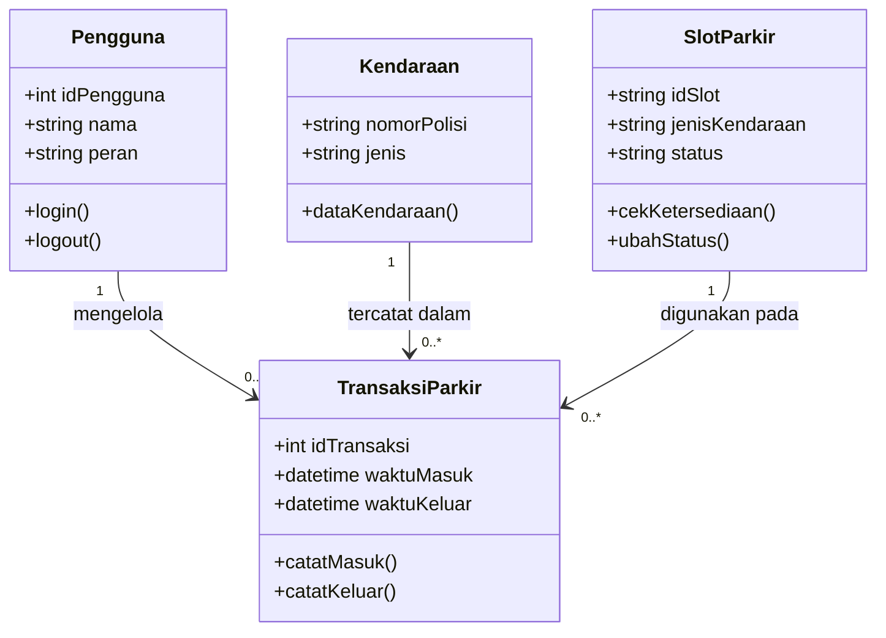
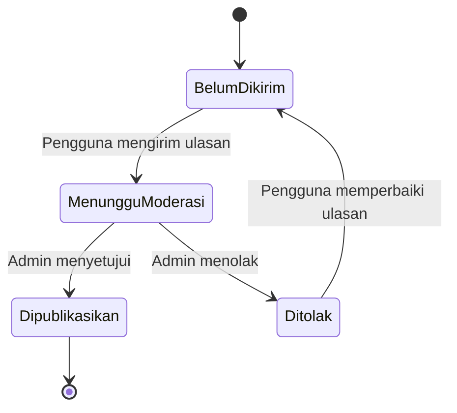

## 1. Class Diagram

### Keterangan Class
- **Pengguna:** menyimpan informasi pengguna sistem.
- **Kendaraan:** menyimpan nomor polisi dan jenis kendaraan.
- **SlotParkir:** menyimpan identitas slot dan status kosong atau terisi.
- **TransaksiParkir:** menyimpan waktu kendaraan masuk dan keluar.

## 2. State Diagram

State diagram berikut menggambarkan status **Review/Ulasan Parkir**.

### Keterangan Status
- **Belum Dikirim:** pengguna belum mengirim ulasan.
- **Menunggu Moderasi:** ulasan menunggu pemeriksaan admin.
- **Dipublikasikan:** ulasan disetujui dan dapat dilihat pengguna lain.
- **Ditolak:** ulasan tidak disetujui dan perlu diperbaiki sebelum dikirim kembali.
