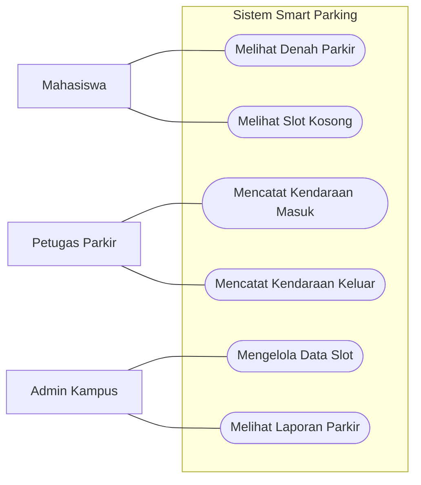
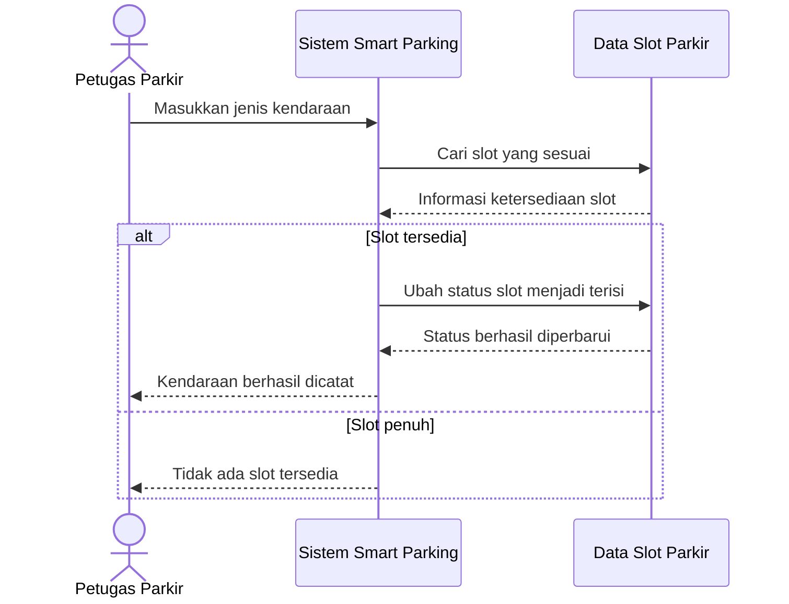

## 1. Use Case Diagram

Aktor: Mahasiswa, Petugas Parkir, dan Admin Kampus.

## 2. Sequence Diagram

Use case yang dipilih: **Mencatat Kendaraan Masuk**.

- **Dipublikasikan:** ulasan disetujui dan dapat dilihat pengguna lain.
- **Ditolak:** ulasan tidak disetujui dan perlu diperbaiki sebelum dikirim kembali.
