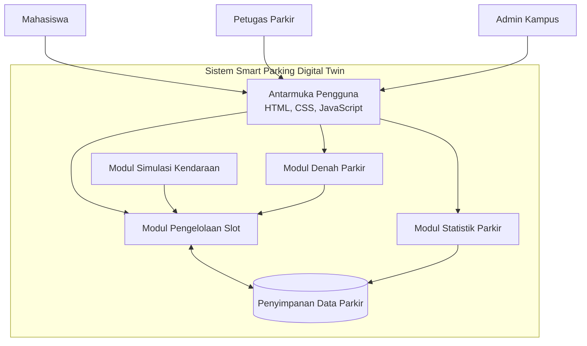
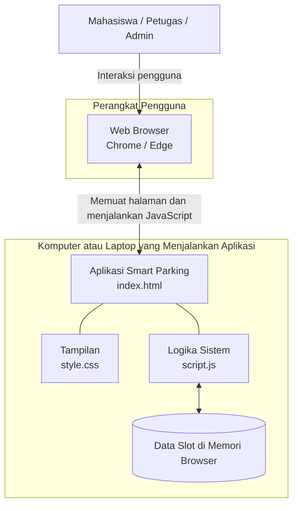

# Component Diagram dan Deployment Diagram

**Proyek:** Smart Parking Digital Twin Kampus  
**Teknologi prototipe:** HTML, CSS, JavaScript

## 1. Component Diagram

Component Diagram menunjukkan bagian-bagian perangkat lunak dalam sistem Smart Parking dan hubungan antarkomponen.

## 2. Deployment Diagram

Deployment Diagram menunjukkan perangkat yang menjalankan aplikasi serta penempatan file dan data sistem.

antarkomponen. Deployment Diagram menjelaskan tempat aplikasi dijalankan dan bagaimana browser, file aplikasi, serta data sementara digunakan. Kedua diagram saling melengkapi dalam dokumentasi perancangan sistem.
