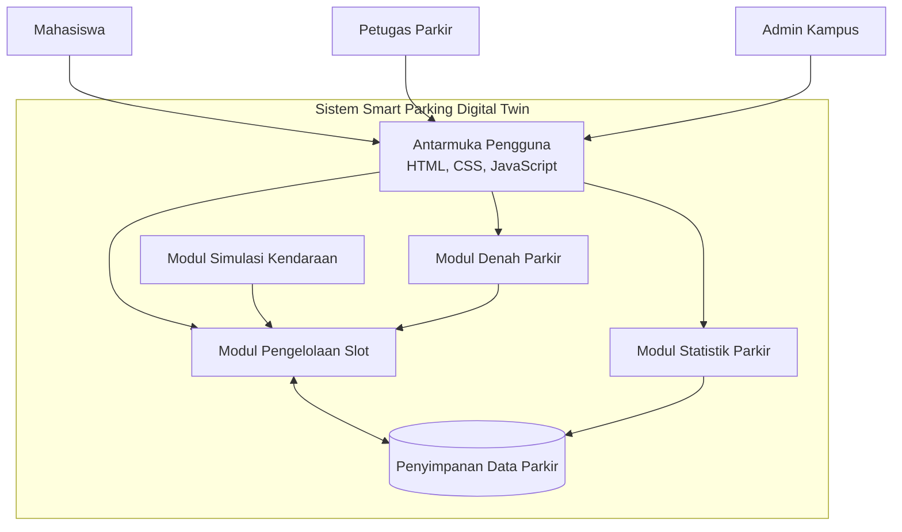
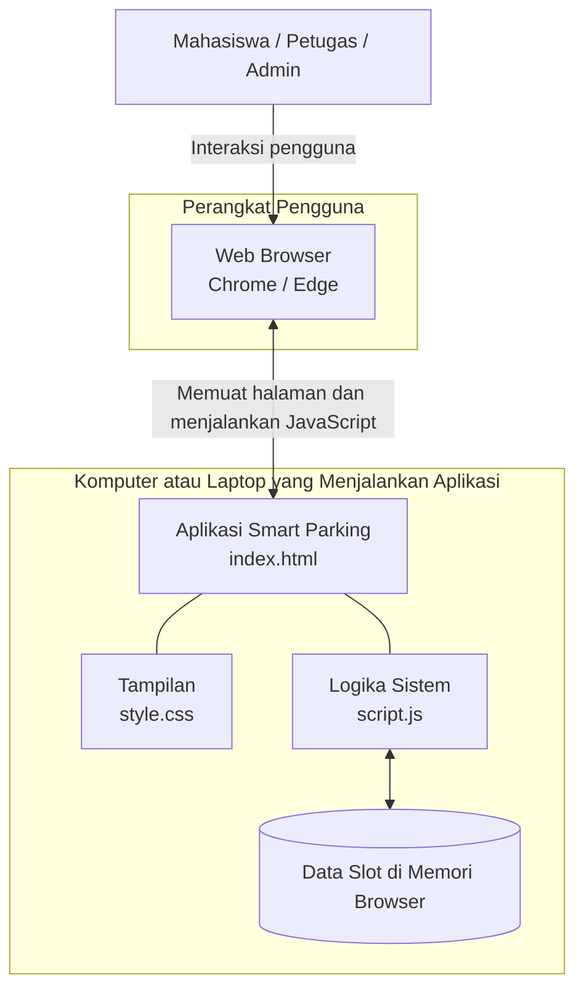

# Component Diagram dan Deployment Diagram

**Proyek:** Smart Parking Digital Twin Kampus  
**Teknologi prototipe:** HTML, CSS, JavaScript

## 1. Component Diagram

Component Diagram menunjukkan bagian-bagian perangkat lunak dalam sistem Smart Parking dan hubungan antarkomponen.

### Penjelasan komponen

| Komponen | Fungsi |
|---|---|
| Antarmuka Pengguna | Menampilkan halaman web bagi mahasiswa, petugas, dan admin. |
| Modul Simulasi Kendaraan | Menyimulasikan kendaraan masuk dan keluar secara otomatis. |
| Modul Denah Parkir | Menampilkan denah kampus dan posisi slot parkir. |
| Modul Pengelolaan Slot | Mengatur status slot kosong atau terisi. |
| Modul Statistik Parkir | Menghitung dan menampilkan total slot, slot kosong, dan slot terisi. |
| Penyimpanan Data Parkir | Menyediakan data status slot bagi komponen lain. |

### Alur kerja

1. Pengguna berinteraksi melalui antarmuka web.
2. Antarmuka menampilkan denah, informasi slot, dan statistik.
3. Modul simulasi mengubah status slot ketika kendaraan masuk atau keluar.
4. Modul pengelolaan slot memperbarui data status parkir.
5. Modul statistik membaca data slot untuk menampilkan informasi terbaru.

**Catatan:** Pada prototipe berbasis HTML, CSS, dan JavaScript tanpa backend, penyimpanan data dapat berupa variabel JavaScript di browser. Komponen penyimpanan pada diagram adalah gambaran logis, bukan berarti sudah ada database server.

## 2. Deployment Diagram

Deployment Diagram menunjukkan perangkat yang menjalankan aplikasi serta penempatan file dan data sistem.

### Penjelasan perangkat dan artefak

| Perangkat / Artefak | Fungsi |
|---|---|
| Perangkat Pengguna | Laptop atau komputer yang dipakai untuk membuka aplikasi. |
| Web Browser | Menampilkan halaman dan menjalankan JavaScript. |
| `index.html` | Menyusun struktur halaman aplikasi. |
| `style.css` | Mengatur tampilan, denah, warna, dan slot parkir. |
| `script.js` | Menjalankan simulasi serta memperbarui status slot. |
| Data Slot di Memori Browser | Menyimpan status slot sementara saat aplikasi berjalan. |

### Alur kerja

1. Pengguna membuka aplikasi melalui browser.
2. Browser memuat file `index.html`, `style.css`, dan `script.js`.
3. JavaScript menjalankan simulasi kendaraan dan memperbarui status slot.
4. Browser menampilkan perubahan pada denah dan statistik parkir.

**Catatan:** Diagram ini menggambarkan prototipe tanpa backend. Jika aplikasi dijalankan secara lokal, perangkat pengguna dan komputer yang menyimpan file aplikasi bisa merupakan perangkat yang sama. Jika kelak memakai server dan database, diagram perlu diperbarui dengan node server aplikasi dan database. Data yang hanya disimpan di memori browser akan hilang saat halaman dimuat ulang.

## 3. Perbedaan Component Diagram dan Deployment Diagram

| Aspek | Component Diagram | Deployment Diagram |
|---|---|---|
| Fokus | Struktur perangkat lunak | Penempatan aplikasi pada perangkat |
| Menampilkan | Modul denah, slot, simulasi, statistik | Browser, komputer, file aplikasi, penyimpanan |
| Pertanyaan utama | Apa saja bagian penyusun sistem? | Di perangkat mana sistem dijalankan? |
| Tujuan | Memahami arsitektur perangkat lunak | Memahami arsitektur saat aplikasi dijalankan |

## 4. Kesimpulan

Component Diagram menjelaskan komponen yang membentuk aplikasi Smart Parking Digital Twin Kampus beserta hubungan antarkomponen. Deployment Diagram menjelaskan tempat aplikasi dijalankan dan bagaimana browser, file aplikasi, serta data sementara digunakan. Kedua diagram saling melengkapi dalam dokumentasi perancangan sistem.
